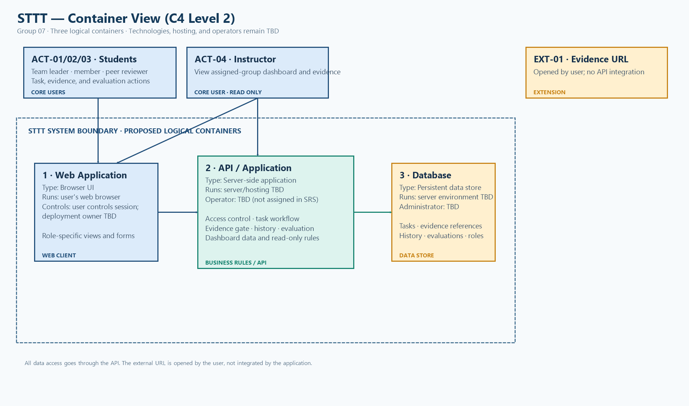

# 11 — Conceptual Architecture

> **Week 11 deliverable**
> **โครงการ:** ระบบติดตามงานกลุ่มและการแบ่งบทบาทสมาชิก (Student Teamwork Task Tracking: STTT)
> **ทีม:** ENGSE206 Group 07 | **เวอร์ชัน:** v0.1 — Design Draft
> **สถานะ:** Architecture Candidate; SRS v1.0 ยังเป็น Review Required — not approved baseline
> **เอกสารอ้างอิง:** [SRS v1](../docs/07-srs-v1.md), [Design Strategy](10-design-strategy.md), [Week 11 Miro summary](../evidence/week-11/miro_af.png)

เอกสารนี้ขยายกลยุทธ์จาก W10 เป็นมุมมองสถาปัตยกรรมระดับแนวคิด ไม่กำหนด framework, hosting, database vendor หรือบริการยืนยันตัวตนที่ยังไม่มีข้อสรุปใน SRS

## สารบัญ

1. [สิ่งที่รับมาจาก W10](#1-สิ่งที่รับมาจาก-w10)
2. [System Context — C4 ระดับ 1](#2-system-context--c4-ระดับ-1)
3. [Container View — C4 ระดับ 2](#3-container-view--c4-ระดับ-2)
4. [หน้าที่และสภาพแวดล้อมของ Container](#4-หน้าที่และสภาพแวดล้อมของ-container)
5. [การกระจาย Quality Attributes](#5-การกระจาย-quality-attributes)
6. [Architecture Decision Cards](#6-architecture-decision-cards)
7. [เดิน Design Spine ผ่าน Container](#7-เดิน-design-spine-ผ่าน-container)
8. [Open Decisions ที่กระทบ Architecture](#8-open-decisions-ที่กระทบ-architecture)
9. [ส่งต่องาน W12 และ W13](#9-ส่งต่องาน-w12-และ-w13)
10. [Checklist สำหรับ W11](#10-checklist-สำหรับ-w11)
11. [การบันทึก AI use และ Team Worklog](#11-การบันทึก-ai-use-และ-team-worklog)

## 1. สิ่งที่รับมาจาก W10

| Input จาก W10 | ข้อสรุป/ข้อกำหนดของ STTT | ผลต่อ Architecture |
|---|---|---|
| Scope | ระบบติดตามงานและเก็บหลักฐานสำหรับหนึ่งรายวิชา/โครงการ; ไม่มี Chat/Video และไม่เชื่อมระบบให้คะแนนมหาวิทยาลัย | มี Task, Evidence, History, Peer Evaluation และ Dashboard เป็นความสามารถหลัก; ไม่สร้าง chat, grading integration หรือ notification service ใน baseline ปัจจุบัน |
| Design drivers | บังคับหลักฐานก่อน Done (BR-01); จำกัดข้อมูลตามกลุ่มและบทบาท (NFR-02, BR-03); บันทึกการเปลี่ยนเจ้าของงานพร้อมเวลาและถ้อยคำเป็นกลาง (BR-04, NFR-03, NFR-04) | วางกฎตรวจหลักฐานไว้ใน workflow เปลี่ยนสถานะ; ตรวจสิทธิ์ทุกคำขอ; แยกประวัติการเปลี่ยนเจ้าของจากข้อมูลเจ้าของปัจจุบัน |
| Design Spine | สร้าง/มอบหมายงาน → อัปเดตสถานะและแนบหลักฐาน → ส่งต่องานและบันทึกประวัติ → Peer Evaluation และ Dashboard อาจารย์ | ใช้เดินคำขอข้าม UI, application rules และ data store ในหัวข้อ 7 |
| Open Decisions | OI-01 เงื่อนไข Peer Evaluation; OI-02 Notification ใน MVP; OI-03 Mobile Responsive; OI-04 trace AC-09/AC-10 กับ User Story | ต้องไม่สร้าง dependency หรือ policy ที่ถือว่าตัดสินใจแล้ว; แสดงผลกระทบและสิ่งที่ทำได้ระหว่างรอในหัวข้อ 8 |

## 2. System Context — C4 ระดับ 1

STTT เป็นระบบเดียวที่รับคำขอจากผู้ใช้สี่บทบาท แสดงระบบและผู้ใช้ภายนอกที่เกี่ยวข้อง โดยไม่มีการเชื่อมต่อ API กับแชตหรือระบบให้คะแนน

Editable source: [context-c4-level1.mmd](../diagrams/architecture/context-c4-level1.mmd).

| Actor / External | ใช้งานหรือให้ข้อมูลอะไร | สิ่งที่ได้รับ | ขอบเขต/สถานะ |
|---|---|---|---|
| ACT-01 หัวหน้ากลุ่ม | สร้างงาน มอบหมาย/เปลี่ยนผู้รับผิดชอบ ดู Dashboard ทีม และทำงานที่ตนรับผิดชอบ | รายการงาน ผลการบันทึก และประวัติการเปลี่ยนผู้รับผิดชอบ | **Core actor**; สิทธิ์ตาม SRS 2.2 |
| ACT-02 สมาชิกกลุ่ม | ดูงานของตน เปลี่ยนสถานะ และแนบไฟล์/ลิงก์/ข้อความเป็นหลักฐาน | สถานะงาน ผลการบันทึก และประวัติที่เกี่ยวข้อง | **Core actor**; แก้ไขได้เฉพาะงานที่ตนรับผิดชอบตาม BR-02 |
| ACT-03 เพื่อน Reviewer | ส่ง Peer Evaluation ตามเกณฑ์/ช่วงเวลาที่ทีมตกลง | สถานะการส่งและผลที่เปิดให้เห็นตามสิทธิ์ | **Core actor**; เงื่อนไขการเปิดรอบยังเป็น OI-01 |
| ACT-04 อาจารย์ผู้สอน | ดู Dashboard และหลักฐานของงานที่สำเร็จตามขอบเขต | ภาพรวมงานเสร็จ/ค้างและหลักฐานแบบ read-only | **Core actor**; เฉพาะกลุ่ม/รายวิชาที่เกี่ยวข้อง; ห้ามแก้ไข/ลบ; ยึด BR-03 และ DEC-02 |
| EXT-01 External Cloud Storage / URL | ไม่ได้เชื่อม API; สมาชิกอาจกรอก URL ไปยังหลักฐานที่จัดเก็บภายนอก | ผู้ใช้เปิด URL ภายนอกด้วยตนเอง | **Extension** ตาม SRS; ความพร้อม/สิทธิ์/validation ยัง TBD |
| EXT-02 External Communication Channel | ไม่มีข้อมูลเข้า/ออกผ่าน API | ไม่มี | **Out of scope** ตาม SRS และ DEC-01 |
| EXT-03 University Grading System | ไม่มีข้อมูลคะแนนเข้า/ออก | ไม่มี | **Out of scope** ตาม SRS C-02 |
| Identity Provider / Authentication Service | อาจใช้ยืนยันตัวตน; ยังไม่มีการเลือก provider หรือยืนยันการเชื่อมต่อ | ยืนยันตัวตน/ข้อมูลผู้ใช้ หากทีมเลือก integration ภายหลัง | **TBD**; ไม่ใช่ dependency ที่ยืนยันแล้ว |

## 3. Container View — C4 ระดับ 2

มุมมองนี้แบ่งระบบตามขอบเขตการรัน/ความรับผิดชอบเชิงตรรกะ ไม่ได้หมายความว่าต้อง deploy เป็นหลาย service และยังไม่ผูกกับเทคโนโลยีที่ทีมไม่ได้เลือก

Editable sources: [draw.io layout](../diagrams/architecture/container-c4-level2.drawio) and [Mermaid logical view](../diagrams/architecture/container-c4-level2.mmd). PNG exports are available for both C4 views; the team still needs to review the labels and relationships.

## 4. หน้าที่และสภาพแวดล้อมของ Container

| Container | ชนิด / ที่รัน | ผู้ควบคุม / ผู้ดูแล | หน้าที่หลักและข้อมูลเข้า/ออก | Requirement ที่เกี่ยวข้อง |
|---|---|---|---|---|
| Web Application | Browser ของผู้ใช้; ใช้งานผ่านเว็บ; responsive behavior ยังรอยืนยัน OI-03 | ผู้ใช้ควบคุมการใช้งาน; deployment/maintenance owner ยังไม่ระบุ | แสดง Task Board, form, Evidence, History, Peer Evaluation และ Dashboard ตาม role; ส่ง request ให้ API และแสดงผล/validation | FR-01–FR-09, FR-11, NFR-01; OI-03 |
| API / Application | ฝั่ง server; hosting และ deployment ยังไม่เลือก | ผู้ดูแลระบบ/ผู้ดำเนินงานยังไม่ระบุใน SRS; ระบุเป็น TBD | ตรวจ role/group; จัดการ task/status; ตรวจ evidence ก่อน Done; บันทึก reassignment; ประมวลผล peer evaluation/dashboard; อ่าน/เขียน store | FR-02–FR-09, FR-11, BR-01–BR-04, NFR-02–NFR-04 |
| Database / Persistent Store (logical) | ฝั่ง server/managed data environment; database technology, schema และ hosting TBD | Data administrator/operator ยังไม่ระบุ; เข้าถึงผ่าน API เท่านั้น | จัดเก็บ Users/Roles, Groups, Tasks, Evidence references/metadata, Reassignment History และ Evaluations | DR-01–DR-05, NFR-02, NFR-03 |

**Trust boundary (แนวคิด):** ทุก request จาก browser ต้องผ่าน Application Layer ซึ่งตรวจผู้ใช้ บทบาท กลุ่ม และสิทธิ์ของ action ก่อนอ่าน/เขียนข้อมูล ไม่มีการให้ browser ต่อ Data Store โดยตรง การยืนยันตัวตน/วิธีสร้าง session ยังไม่เลือก และไม่สมมติ SSO

## 5. การกระจาย Quality Attributes

| Attribute / Driver | Container ที่รับผิดชอบ | Tactic / เกณฑ์ตรวจสอบ |
|---|---|---|
| Usability — NFR-01 | Web Client | งานและกำหนดส่งมองเห็นง่าย; flow อัปเดตสถานะสั้น; ตรวจด้วยเกณฑ์ SRS ว่าสมาชิกใหม่อัปเดตงานครั้งแรกได้ภายใน 5 นาที |
| Privacy — NFR-02 | Application Layer + Data Store | ตรวจสิทธิ์ตาม role และ group ในทุกคำขอ; ทดสอบบัญชีต่างกลุ่มว่าอ่านข้อมูลและหลักฐานกันไม่ได้ |
| Read-only instructor — FR-07, BR-03 | Web Client + Application Layer | UI ไม่มี action แก้/ลบสำหรับอาจารย์ และ Application Layer ปฏิเสธ mutation แม้ส่ง request โดยตรง |
| Evidence gate — BR-01 | Application Layer + Data Store | ตรวจหลักฐานก่อนบันทึก Done; หากไม่มีหลักฐานให้ปฏิเสธและคงสถานะเดิม |
| Auditability — NFR-03, FR-05, BR-04 | Application Layer + Data Store | บันทึกเจ้าของเดิม/ใหม่และเวลา; สมาชิกทั่วไปแก้/ลบประวัติไม่ได้; รายละเอียด append-only และ transaction ลงใน Detailed Design |
| Neutral wording — NFR-04 | Web Client | แสดงเหตุการณ์ใน History ด้วยข้อความเป็นกลาง ตรวจข้อความใน prototype/design review |
| Mobile Responsive — OI-03 | Web Client | ยังไม่เป็น baseline; หากยืนยัน ให้ทดสอบ flow หลักบนมือถือและอัปเดต requirement/verification |
| NFR-05 — อ้างถึงเฉพาะใน SRS VF-05 ไม่อยู่ในรายการ baseline NFR | Web Application — TBD จนยืนยัน OI-03 | ตรวจว่าต้องเพิ่ม/แก้ requirement ก่อนใช้เป็นเกณฑ์รับมอบ; ห้ามถือเป็น NFR ที่อนุมัติแล้ว |
| Notification — OI-02 | ยังไม่มี container ใน baseline | FR-10 เป็น Could/Deferred; รอการตัดสินใจเรื่อง MVP ก่อนเพิ่ม Notification component หรือ external dependency |

## 6. Architecture Decision Cards

รายการนี้เป็นทิศทางสถาปัตยกรรมสำหรับตรวจทาน ไม่ใช่การเพิ่ม DEC ที่อนุมัติแล้วใน decision log

| ID | Decision / Status | ทางเลือกและทิศทางที่เสนอ | Driver / เหตุผล | ผลกระทบ |
|---|---|---|---|---|
| AD-01 | แบ่งระบบเป็น Web Application, API/Application และ Database — **Proposed** | ใช้ 3 logical containers; ยังไม่กำหนด technology หรือ deployment topology | แยก UI, access/business rules และ persistence ให้ trace ได้ตาม scope stand-alone | ระบุ runtime/owner TBD ในตาราง; ต้องยืนยัน implementation ภายหลัง |
| AD-02 | บังคับ access control, evidence gate และประวัติการส่งต่องานที่ตรวจสอบได้ — **Required by SRS** | ให้ API/Application ตรวจ role/group และกฎ BR-01–04 ก่อนเปลี่ยนข้อมูล | NFR-02–04, FR-04/05/07/11, BR-01–04 | ครอบคลุม privacy, read-only teacher, Done validation และ audit history; รายละเอียด transaction ลง W13 |
| AD-03 | คง external integrations ที่ยังไม่ยืนยันเป็น TBD/Extension — **Open / Deferred** | ไม่เลือก identity provider, cloud file API หรือ notification service จนกว่าจะปิด issue ที่เกี่ยวข้อง | OI-01–OI-03, EXT-01 และ NFR-05/VF-05 discrepancy | diagrams แสดงขอบเขตโดยไม่สร้าง dependency; ต้องอัปเดตหลังทีม/อาจารย์ยืนยัน |

## 7. เดิน Design Spine ผ่าน Container

| ขั้น | Workflow (จาก Miro/SRS) | การเดินผ่าน Container | กฎ/ผลที่ต้องเกิด |
|---|---|---|---|
| 1 — สร้างและมอบหมายงาน | หัวหน้ากลุ่มสร้าง task ระบุผู้รับผิดชอบและกำหนดส่ง | Web Client ส่งข้อมูล → Application Layer ตรวจ role/ข้อมูล → Data Store บันทึก task → ผลกลับ Web Client และแสดงในรายการของผู้รับผิดชอบ | หัวหน้ากลุ่มสร้าง/มอบหมายได้; สมาชิกเห็นงานของตน (FR-01, FR-02, BR-02) |
| 2 — อัปเดตสถานะและแนบหลักฐาน | สมาชิกเปลี่ยน To do → Doing; เมื่อพร้อมปิดแนบไฟล์/URL/ข้อความแล้วเลือก Done | Web Client ส่ง status/evidence → Application Layer ตรวจเจ้าของและตรวจ evidence gate → Data Store บันทึกข้อมูลที่สัมพันธ์กับ task → Web Client แสดงผลหรือ validation error | Done ต้องมีหลักฐาน; ถ้าไม่มีให้คงสถานะเดิม (FR-03, FR-04, BR-01) |
| 3 — เปลี่ยนผู้รับผิดชอบ | หัวหน้ากลุ่มส่งต่องานเมื่อสมาชิกเปลี่ยนบทบาท/ไม่สามารถทำต่อ | Web Client ส่ง reassignment → Application Layer ตรวจสิทธิ์และบันทึก event → Data Store เก็บเจ้าของปัจจุบันและประวัติพร้อม timestamp → UI แสดงข้อความเป็นกลาง | ประวัติต้องครบและสมาชิกทั่วไปแก้/ลบไม่ได้ (FR-05, BR-04, NFR-03, NFR-04) |
| 4 — Peer Evaluation / Instructor Dashboard | Reviewer ส่งแบบประเมินตามเงื่อนไขที่ตกลง; อาจารย์เปิด Dashboard/หลักฐานที่อนุญาต | Web Client ส่งคำขอ → Application Layer ตรวจ role/group และเงื่อนไขที่อนุมัติ → Data Store อ่าน/บันทึกตามสิทธิ์ → แสดงผลตาม role | Reviewer policy ยังติด OI-01; อาจารย์อ่านอย่างเดียวและเห็นเฉพาะข้อมูลที่อนุญาต (FR-06–FR-09, BR-03) |
| Cross-cutting — Privacy | ทุกคำขออ่าน/เขียน task, evidence, history หรือ evaluation | ทุก request ผ่าน access control ใน Application Layer ก่อนแตะ Data Store | ปฏิเสธคำขอข้ามกลุ่ม/ผิด role; ไม่มี direct browser-to-database access (FR-11, NFR-02) |

## 8. Open Decisions ที่กระทบ Architecture

| Issue | ประเด็น | Container / Artefact ที่กระทบ | แนวทางระหว่างรอข้อสรุป |
|---|---|---|---|
| OI-01 | เงื่อนไข/ช่วงเวลาการเปิด Peer Evaluation ยังไม่ยืนยัน | Application Layer (policy), Web Client (visibility/flow), data model/UC | ทำโมดูลเป็น logical capability ได้ แต่ยังไม่ hard-code เงื่อนไขว่า task ต้อง Done; ยืนยันกับอาจารย์แล้วบันทึก business rule/decision |
| OI-02 | จะรวม Notification ใน MVP หรือไม่ | อาจเพิ่ม Notification module/service และ Web Client; external channel หากเลือก | ไม่เพิ่มเป็น dependency ตอนนี้; ทำ Value vs Effort และบันทึก scope decision; FR-10 ยังคง Deferred |
| OI-03 | Mobile Responsive จะเป็น requirement/baseline หรือไม่ | Web Client, UX prototype, verification criteria | ออกแบบหน้าจออย่างระมัดระวังได้ แต่ยังไม่อ้างเป็น acceptance baseline; ทดสอบกับผู้ใช้และปรึกษาอาจารย์ |
| OI-04 | AC-09/AC-10 อ้าง US-09/US-10 ซึ่งไม่มีใน User Story table | SRS traceability และ downstream design/test mapping | ไม่สร้าง use case/โมดูลจาก trace ที่ยังไม่ยืนยัน; ตรวจ W06 source แล้วแก้ trace ก่อนอนุมัติ baseline |

## 9. ส่งต่องาน W12 และ W13

**W12 — UX/UI Prototype**

- ออกแบบ Task Board และ flow สร้าง/มอบหมายงานให้สอดคล้อง FR-01/FR-02
- ทำ state/validation สำหรับ To do, Doing และ Done พร้อมกรณีไม่มี evidence
- ออกแบบมุมมองสมาชิก หัวหน้ากลุ่ม Reviewer และอาจารย์ โดยแสดง action ตาม role และยึดข้อจำกัด read-only
- ระบุข้อความกลางสำหรับ reassignment history; เตรียมตรวจ mobile responsive เมื่อ OI-03 มีข้อสรุป

**W13 — Detailed Design**

- กำหนด entity/relationship สำหรับ User/Role, Group, Task, Evidence, Reassignment History และ Peer Evaluation
- ระบุ interface/sequence ของการอัปเดตสถานะพร้อม evidence และการเปลี่ยนผู้รับผิดชอบ
- กำหนด transaction/error handling, authorization checks, audit protection และแนวทางการเก็บไฟล์/URL
- ปิดหรือแสดง TBD สำหรับ OI-01/OI-02/OI-04 ก่อนยืนยัน detailed behavior

## 10. Checklist สำหรับ W11

- [x] **Context:** มี STTT หนึ่งระบบ Actors และ external systems พร้อมสถานะ Core / Extension / Out of scope / TBD
- [x] **Container:** แสดง 3 logical containers (Web, API, Database) และระบุที่รัน/ผู้ควบคุมเป็นข้อมูลจริงหรือ TBD
- [x] **NFR + Decisions:** map NFR-01–04 และระบุ NFR-05 ที่อ้างเฉพาะ VF-05 เป็น discrepancy; มี Decision Cards ไม่เกิน 3 ใบ
- [x] **Spine:** เดิน workflow หลักผ่าน Web → API → Database และระบุกฎ/ผลที่คาดหวัง
- [x] **Open decisions:** แสดงผลกระทบของ OI-01–04 และแนวทางระหว่างรอข้อสรุป
- [x] **Export:** มี PNG exports ของ Context และ Container ใน `diagrams/architecture/` และฝังไว้ในเอกสาร

**Peer review checkpoint — pending:** ให้คู่ตรวจหัวข้อ 3–4 บน Miro และถามว่า driver สำคัญของทีมอยู่ container ใด จากนั้นบันทึก feedback ใน `evidence/week-11/` ก่อนนับ W11 ว่าผ่านการ review

## 11. การบันทึก AI use และ Team Worklog

การใช้ AI ที่ช่วยจัดโครงสร้างหรือร่างเอกสารนี้ควรบันทึกใน [project-management/ai-use-log.md](../project-management/ai-use-log.md) และให้สมาชิกตรวจความถูกต้องกับ SRS, W10 และหลักฐาน Miro ก่อนส่ง ห้ามบันทึกว่า AI เป็นผู้ตัดสินใจแทนทีม

การแบ่งงานและสถานะการตรวจทานของสมาชิกให้บันทึกใน [project-management/team-worklog.md](../project-management/team-worklog.md) ตามการทำงานจริง ไม่เติมชื่อหรือสถานะงานแทนสมาชิก
